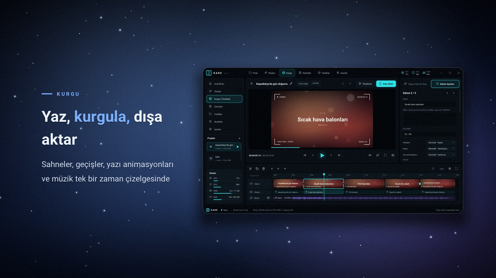
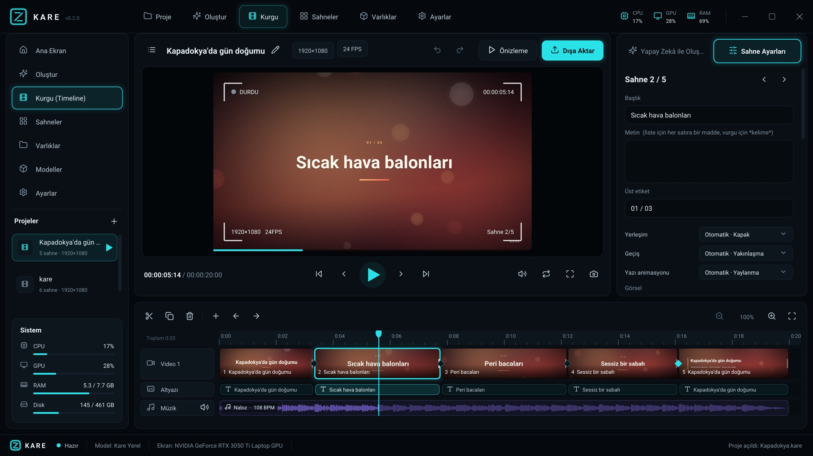

# Kare

Prompt yazın, videoyu bilgisayarınızda oluşturun ve kurgulayın.

[](https://github.com/Hydra-Ai-tr/kare/releases/download/v0.2.0/kare-tanitim.mp4)

*Yukarıdaki tanıtım videosu Kare ile yapıldı: [`docs/promo/kare-tanitim.kare`](docs/promo/kare-tanitim.kare). İzlemek için görsele tıklayın.*

Kare, C++17 ile yazılmış yerel bir video stüdyosudur. Bir cümle, madde listesi ya da GitHub bağlantısı verirsiniz; uygulama bunu süreli sahnelere böler, yerleşim, geçiş, yazı animasyonu ve müzik seçer, kareleri işlemcinizde çizer ve MP4 ya da AVI olarak kaydeder. İnternet gerekmez. İsterseniz sahne metnini Ollama, LM Studio, Kor Studio ya da bir bulut API'si yazsın; pikseller ve ses yine bu bilgisayarda üretilir.

Kare bir video difüzyon modeli değildir ve dev bir model dosyası indirmez. Ürettiği şey hareketli grafik kurgusudur: tipografi, renk, ışık, kamera hareketi, sizin görselleriniz ve müzik. Metni, süreyi, sırayı ve görünümü siz değiştirir, sonra yeniden dışa aktarırsınız.



## Ne yapar

- Türkçe ve İngilizce promptu çevrimdışı kurgular: `8 saniye`, `dikey`, `başlık: "Boğaz"`, madde listesi, `Kapadokya: balonlar, peri bacaları ve sabah` gibi virgüllü cümleler.
- GitHub bağlantısı yapıştırınca repoyu inceler (README, diller, yıldız, derleme araçları) ve tanıtım videosu kurar.
- 11 yerleşim: kapak, açıklama, liste, sayı, alıntı, iki sütun, terminal, çubuk grafik, görsel, vitrin, kapanış.
- 7 geçiş: çapraz geçiş, kaydırma, silme, yakınlaşma, flaş, glitch, kesme.
- Kelime kelime yazı animasyonları (yükselme, belirme, daktilo, açılma, yay) ve `*vurgu*` işareti.
- Kendi müziğini besteler: ambient, nabız, sürüş, lofi. Kesmelerde whoosh, kapanışta riser ve boom. Sahneler müziğin vuruşuna oturur.
- Görünümler: sinema, gün batımı, gece, deniz, orman, neon, kağıt, sade. Film greni ve sinema bantları.
- Zaman çizelgesi: video, altyazı ve müzik şeritleri, dalga formu, geçiş noktaları, sürükleyerek süre ayarı.
- Her yerde sağ tık menüleri: sahne, geçiş, müzik, önizleme, proje ve dosyalar.
- Özel pencere başlığı, sesli önizleme, PNG kare kaydı, WAV müzik kaydı.
- Windows'ta H.264 + AAC MP4 (Media Foundation), her yerde açılan MJPEG + PCM AVI. Dışa aktarma tüm işlemci çekirdeklerini kullanır.
- İsteğe bağlı OpenAI uyumlu API, yalnızca hikâye panosu için.

## Kurulum

[Sürümler](https://github.com/Hydra-Ai-tr/kare/releases/latest) sayfasından `kare-0.2.0-windows-x64.zip` dosyasını indirip açın. `kare.exe` masaüstü uygulamasıdır, `kare-cli.exe` komut satırıdır. Windows 10 veya daha yenisi gerekir.

İmza henüz yok. SmartScreen uyarırsa **Diğer bilgiler → Yine de çalıştır**.

## Hızlı başlangıç

1. **Oluştur** sayfasına bir prompt ya da GitHub bağlantısı yazın. Örnek: `Kapadokya'da gün doğumu: sıcak hava balonları, peri bacaları ve sessiz bir sabah, 20 saniye`
2. **Planla**. Kurgu sayfasında sahnelere sağ tıklayıp yerleşim, geçiş, animasyon ve müziği değiştirin.
3. **Dışa Aktar**.

Kısayollar: `Boşluk` oynat, `←/→` sahne, `S` böl, `Ctrl+D` çoğalt, `Delete` sil, `M` sessiz, `Ctrl+Z/Y` geri al/yinele, `Ctrl+S` kaydet.

Komut satırı:

```text
kare-cli plan "Gün batımında sahil, 8 saniye" -o sahil.kare
kare-cli plan https://github.com/Hydra-Ai-tr/kare -o kare.kare
kare-cli render --project kare.kare -o tanitim.mp4
kare-cli render "Dikey tanıtım" -o tanitim.mp4 --seconds 10 --aspect 9:16
kare-cli frame "Night market, 6 seconds" -o kare.png
kare-cli audio --project kare.kare -o muzik.wav
kare-cli selftest
```

Dikey video için prompta `dikey` veya `9:16` yazın. Kare kare için `1:1` veya `square`. Süreyi `8 saniye` / `6 seconds` diye söyleyin. Başlığı `Başlık: "Boğaz"` veya `title: Hello` diye ayırın.

Arayüz ekran görüntüleri pencere açmadan da alınabilir: `kare.exe proje.kare --shot ekran.png --page edit --size 1600x900`.

## API

Ayarlar'dan bir adres seçin. Kapalıyken her şey çevrimdışıdır. Açıkken yalnızca prompt, seçtiğiniz adrese gider; video kareleri gitmez.

| Sağlayıcı | Adres |
|---|---|
| Ollama | `http://127.0.0.1:11434/v1` |
| LM Studio | `http://127.0.0.1:1234/v1` |
| Kor Studio | `http://127.0.0.1:8080/v1` (`kor-cli serve`) |
| OpenAI, Groq | bulut, API anahtarı gerekir |

Anahtar `%APPDATA%\Kare\config.json` içindedir (`KARE_CONFIG_DIR` ile değiştirilebilir). API cevap vermezse Kare yerel kurgusuna döner ve nedenini yazar.

## Derleme

CMake 3.20+, Ninja ve MinGW-w64 GCC 13+ (örneğin `winget install BrechtSanders.WinLibs.POSIX.UCRT`) ya da Visual Studio 2022. GLFW ve Dear ImGui, CMake tarafından indirilir.

```powershell
git clone https://github.com/Hydra-Ai-tr/kare
cd kare
cmake -B build -G Ninja -DCMAKE_BUILD_TYPE=Release
cmake --build build
build\bin\kare-cli.exe selftest
build\bin\kare.exe
```

## Gizlilik

Çevrimdışı kurgu, müzik ve dışa aktarma ağ kullanmaz. Ağ yalnızca Ayarlar'dan açtığınız API ve yapıştırdığınız GitHub bağlantısı için kullanılır.

## Lisans

[MIT](LICENSE). İstediğiniz gibi kullanabilir, değiştirebilir ve dağıtabilirsiniz.

Üçüncü taraf: [Dear ImGui](https://github.com/ocornut/imgui) (MIT), [GLFW](https://www.glfw.org/) (zlib), [stb](https://github.com/nothings/stb) (public domain), [Roboto](https://github.com/googlefonts/roboto) (Apache-2.0, `assets/fonts/LICENSE-ROBOTO.txt`), [Lucide](https://lucide.dev) (ISC, `assets/fonts/LICENSE-LUCIDE.txt`).

---

# English

Write a prompt. Kare builds the video on your computer, and you can edit it before export.

[](https://github.com/Hydra-Ai-tr/kare/releases/download/v0.2.0/kare-tanitim.mp4)

*The promo above was made with Kare: [`docs/promo/kare-tanitim.kare`](docs/promo/kare-tanitim.kare).*

Kare is a local video studio written in C++17. You give it a sentence, a list, or a GitHub link. It turns that into timed scenes, picks layouts, transitions, text animation, and music, draws the frames on your CPU, and saves an MP4 or an AVI. No internet is required. Optionally, Ollama, LM Studio, Kor Studio, or a cloud API can write the storyboard; pixels and sound are still produced locally.

Kare is not a video diffusion model, and it does not download one. It makes motion graphics: type, color, light, camera moves, your own images, and music. You change the words, the timing, the order, and the look, then export again.

## What it does

- Plans Turkish and English prompts offline (`8 seconds`, `9:16`, `title: "Hello"`, numbered lists, comma-separated clauses).
- Paste a GitHub link and it reads the repository (README, languages, stars, build tools) and cuts a promo.
- 11 layouts: hero, statement, list, stat, quote, split, terminal, bars, media, showcase, end card.
- 7 transitions: fade, slide, wipe, zoom, flash, glitch, cut.
- Word-by-word text animation (rise, fade, type, reveal, spring) with `*highlight*` markup.
- Generated soundtrack: ambient, pulse, drive, lofi. Whooshes on cuts, a riser and boom into the end card. Scenes snap to the beat.
- Looks: cinema, dusk, night, sea, forest, neon, paper, minimal. Film grain and letterbox.
- Timeline with video, caption, and music lanes, waveform, transition markers, and drag-to-trim.
- Right-click menus everywhere: scenes, transitions, music, preview, projects, and files.
- Custom title bar, preview with sound, PNG frame grab, WAV soundtrack export.
- H.264 + AAC MP4 on Windows (Media Foundation), plus MJPEG + PCM AVI. Export uses every CPU core.
- Optional OpenAI-compatible API, used only for the storyboard.

## Install

Download `kare-0.2.0-windows-x64.zip` from [Releases](https://github.com/Hydra-Ai-tr/kare/releases/latest) and unzip it. `kare.exe` is the app, `kare-cli.exe` is the command line. Windows 10 or newer.

The build is not signed yet. If SmartScreen appears, choose **More info → Run anyway**.

## Quick start

1. On **Create**, write a prompt or paste a GitHub link. Example: `Dusk over the harbor: boats, gulls and city lights, 12 seconds`
2. Press **Plan**. Right-click scenes on **Edit** to change layout, transition, animation, and music.
3. Press **Export**.

Shortcuts: `Space` play, `←/→` scene, `S` split, `Ctrl+D` duplicate, `Delete` delete, `M` mute, `Ctrl+Z/Y` undo/redo, `Ctrl+S` save.

```text
kare-cli plan "Night market, 6 seconds" -o market.kare
kare-cli plan https://github.com/owner/repo -o repo.kare
kare-cli render --project repo.kare -o promo.mp4
kare-cli frame "Hello" -o frame.png
kare-cli audio --project repo.kare -o music.wav
kare-cli selftest
```

UI screenshots can be taken without opening a window: `kare.exe project.kare --shot ui.png --page edit --size 1600x900`.

## API

Pick an endpoint in Settings. With it off, everything stays offline. With it on, only the prompt is sent to the address you chose. Frames are not uploaded.

| Provider | Address |
|---|---|
| Ollama | `http://127.0.0.1:11434/v1` |
| LM Studio | `http://127.0.0.1:1234/v1` |
| Kor Studio | `http://127.0.0.1:8080/v1` (`kor-cli serve`) |
| OpenAI, Groq | cloud, an API key is required |

The key is stored in `%APPDATA%\Kare\config.json` (override with `KARE_CONFIG_DIR`). If the API fails, Kare falls back to the local planner and shows why.

## Build

CMake 3.20+, Ninja, and MinGW-w64 GCC 13+ or Visual Studio 2022. CMake downloads GLFW and Dear ImGui.

```powershell
git clone https://github.com/Hydra-Ai-tr/kare
cd kare
cmake -B build -G Ninja -DCMAKE_BUILD_TYPE=Release
cmake --build build
build\bin\kare-cli.exe selftest
build\bin\kare.exe
```

## Privacy

Offline planning, music, and export do not use the network. The network is used only for the API you enable in Settings and for GitHub links you paste.

## License

[MIT](LICENSE).

Third party: Dear ImGui (MIT), GLFW (zlib), stb (public domain), Roboto (Apache-2.0, `assets/fonts/LICENSE-ROBOTO.txt`), Lucide (ISC, `assets/fonts/LICENSE-LUCIDE.txt`).
